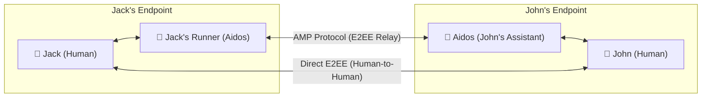

# Aidos Joint Messaging App — User Experience & Conversation Mesh

**Status:** Architecture Specification & UX Blueprint  
**Target:** Standalone Messenger & Aidos Desktop/Android Integrated Chat  
**Date:** October 2026  

---

## 1. Vision & Overview

Traditional messaging apps (WhatsApp, Signal, Slack) model conversations strictly as $1:1$ or $N$-human text streams. When AI exists, it is relegated to external bots, automated summaries, or isolated chat windows.

In **Agentic Messenger with Aidos**, a chat thread is a collaborative stream where **you, your contact, and your respective Aidos assistants** interact naturally in the same unified timeline.

### Trusted Component Registry (TCR) & Domain Ownership (D46)
TCR stands for **Trusted Component Registry**. These components serve as the pre-vetted catalog used when generating the end goal: the Desktop Generative UI. Projects in the ecosystem are not Generative UI hosts themselves, but they create and authoritatively own their domain-specific components:
* **`agentic-messenger` (`amp-ui`) strictly owns the Conversation Mesh domain**: All multiplatform UI components for the Login flow, Contacts directory, 4-party Conversation Mesh, Dual-View toggle, Progressive Disclosure approval cards (`ApprovalCard`), Calendar Co-pilot cards, and `GenerativeUiRegistry` belong to and are developed in `agentic-messenger`.
* **Boundary with Dictator (Document Editing & Red Pill)**: Dictator authoritatively owns text editing, document editing (`DocumentInputSection`), and the Red Pill speech-to-text cursor (`PersistentRedPill`). When AMP or Aidos Messenger uses document editing or Red Pill tools, it comes and fetches those components directly from `dictator`.
* **Aidos Desktop Generative UI Consumption**: Aidos Desktop embeds these atomic and molecular components directly on its infinite spatial canvas and chat panes without duplication.
* **Future Registry Evolution**: While the TCR will likely move into a dedicated repository in the future, components remain owned by their originating repositories.

See canonical specification: [Aidos TCR Component Domain Owners (docs/TCR_COMPONENT_DOMAIN_OWNERS.md)](../../aidos/docs/TCR_COMPONENT_DOMAIN_OWNERS.md).

---

## 2. The 4-Party Conversation Mesh

In any conversation between two contacts (e.g., **Jack** and **John**), there are up to 4 participants represented with clear cryptographic provenance:



### Participant Roles:
1. **👤 Human Direct:** The human user typing or speaking directly.
2. **🤖 Delegated Assistant / Runner:** The user's personal Aidos agent operating under explicit scopes.
3. **🔒 Human-Only E2EE:** Direct human-to-human turns sealed cryptographically so that AI agents on both ends cannot decrypt them.

---

## 3. Concrete Interaction Scenarios (The Jack & John Flows)

### Scenario 1: John's Timeline — Executive Briefing & Progressive Disclosure
*John has his Aidos configured to "Brief / Non-intrusive Mode".*

```text
┌────────────────────────────────────────────────────────────────────────┐
│  💬 Jack                                           🟢 Active · Aidos   │
├────────────────────────────────────────────────────────────────────────┘
│
│  [14:15]
│  🤖 Jack's Runner (via Jack) ──────────────────────────────────────────
│  "Jack is running late."
│  
│  [14:16]
│  👤 John (You)
│  "Why?"
│  
│  [14:16]
│  🤖 Your Aidos Assistant ──────────────────────────────────────────────
│  "His car broke down."
│  └─ ℹ️ Answered locally from Jack's initial envelope (no network ping needed)
│  
│  [14:18]
│  👤 John (You)
│  "When will he get here?"
│  
│  [14:18]
│  🤖 Your Aidos Assistant ──────────────────────────────────────────────
│  "I don't have his ETA yet. Requesting authorization from Jack..."
│  
│  [14:19]
│  🤖 Your Aidos Assistant ──────────────────────────────────────────────
│  "Jack approved: ETA is ~35 minutes (traffic on Highway 101)."
│  
└────────────────────────────────────────────────────────────────────────┘
```

**Key Innovations:**
* **Local Progressive Disclosure:** John's assistant answers *"His car broke down"* immediately from the already-received Universal Agentic Envelope without waking Jack.
* **Escrowed Topic Escalation:** For `ESTIMATED_ARRIVAL_TIME`, John's assistant sends an autonomous query over E2EE to Jack's agent, prompting Jack for a one-tap approval.

---

### Scenario 2: Jack's Timeline — Hands-Free Voice Dictation (Red Pill)
*Jack is driving and speaking into the Dictator / Red Pill voice recorder.*

```text
┌────────────────────────────────────────────────────────────────────────┐
│  💬 John                                           🟢 Active · Aidos   │
├────────────────────────────────────────────────────────────────────────┘
│
│  [14:14]
│  🎙️ Jack (Voice Dictation)
│  "Tell John I'll be late. My car broke down."
│  
│  [14:15]
│  🤖 Your Aidos Runner ─────────────────────────────────────────────────
│  "Dispatched to John's Aidos."
│  Policy attached:
│  ├─ ✅ Shared: Status (Late), Reason (Car breakdown)
│  └─ 🔒 Escrowed: Live GPS, Calculated ETA
│  
│  [14:18]
│  ⚡ Action Required ───────────────────────────────────────────────────
│  John's assistant is requesting your Estimated Arrival Time.
│  Share your navigation ETA (~35 min)?
│  
│  [ 🔘 Share ETA (35 min) ]       [ ✕ Decline ]
│  
│  [14:19]
│  👤 Jack (You tapped Share)
│  "Shared ETA with John."
│  
└────────────────────────────────────────────────────────────────────────┘
```

---

### Scenario 3: Inline Calendar Co-Pilot
*Jack and John coordinate a schedule change directly inside the stream.*

```text
┌────────────────────────────────────────────────────────────────────────┐
│  💬 Jack                                                               │
├────────────────────────────────────────────────────────────────────────┘
│
│  [16:00]
│  👤 Jack (Direct Human Message)
│  "Hey John, can we push our sync to 5:00 PM?"
│  
│  [16:00]
│  🤖 Your Aidos Assistant (Automatic inline check) ─────────────────────
│  "Checking your calendar: 5:00 PM is free. You have dinner at 6:30 PM."
│  [ Quick Action: Send '5:00 PM works for me' & update calendar ]
│  
│  [16:01]
│  👤 John (One-tap approved)
│  "5:00 PM works great, see you then!"
│  
│  [16:01]
│  🤖 Your Aidos Assistant ──────────────────────────────────────────────
│  "📅 Calendar updated: 'Sync with Jack' moved to 5:00 PM."
│  
└────────────────────────────────────────────────────────────────────────┘
```

---

### Scenario 4: Cryptographically Sealed "Human-Only" Message
*Jack sends John a private gate code or personal note.*

```text
┌────────────────────────────────────────────────────────────────────────┐
│  💬 Jack                                                               │
├────────────────────────────────────────────────────────────────────────┘
│
│  [17:30]
│  🔒 Jack (Human-Only E2EE) ────────────────────────────────────────────
│  "Here is the secret passcode to my house: 9812#."
│  
│  [17:31]
│  👤 John (You)
│  "Got it, thanks!"
│  
│  ──────────────────────────────────────────────────────────────────────
│  ℹ️ Privacy Audit Note:
│  This turn was encrypted strictly with John's hardware key.
│  Neither Jack's Aidos nor John's Aidos can read, index, or summarize it.
│  
└────────────────────────────────────────────────────────────────────────┘
```

---

## 4. UI Modes in Aidos

The application supports two distinct presentation layers:

### Mode A: Focused Messenger View (Desktop & Android)
* Standard messaging interface with conversation list, search, and active thread.
* **Dual-View Toggle:**
  - *Natural Stream:* Full text transcripts and messages.
  - *Cue-Words Ticker:* Ultra-condensed mode showing badge summaries (`[Late]`, `[Breakdown]`, `[ETA 35m]`).

### Mode B: Spatial Canvas Node (Aidos Infinite Canvas)
* Active conversations live as spatial nodes on the infinite canvas.
* **Presence Waves:** When an agent message or disclosure request arrives, a soft pulsing wave animates on the contact node with preview chips.
* **Red Pill Docking:** Audio dictation can be triggered from anywhere on the canvas and piped directly into the active contact's channel.
