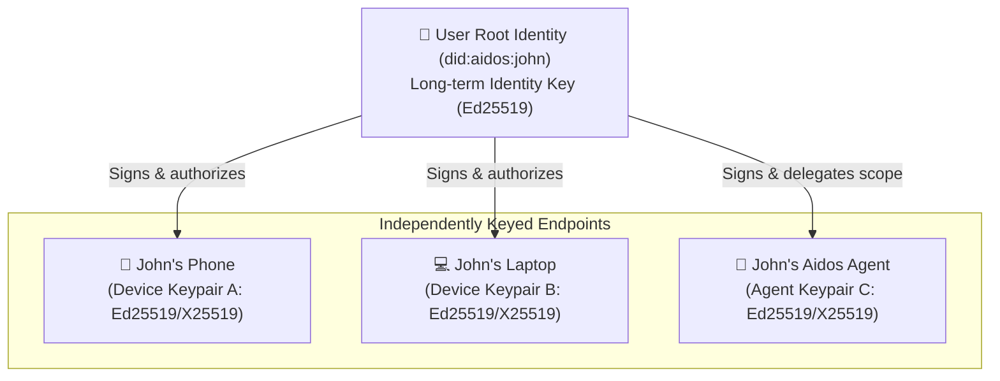

# Cryptographic Identity & Multi-Device Specification

**Status:** Technical Specification  
**Standard Reference:** MLS (RFC 9420) / X3DH & Double Ratchet Adaptation  
**Date:** October 2026  

---

## 1. Core Cryptographic Principles

1. **Zero Shared Private Keys Across Devices:**  
   A private key must never leave the physical device that generated it. Devices never copy or synchronize private keys over the network.
2. **Distinct Keying for Humans vs. Agents:**  
   Every physical human device and every AI agent runtime possesses an independent cryptographic keypair.
3. **Dual-Compartment Payloads:**  
   Envelopes are structured so that message content keys can be withheld from agent keys when marked `HUMAN_ONLY`.
4. **Forward Secrecy & Post-Compromise Security:**  
   Ratchet updates and MLS TreeKEM epoch changes ensure that compromised keys do not reveal past or future messages.

---

## 2. Identity Hierarchy



### 2.1 User Root Identity
* **Identifier:** `did:aidos:<hash-of-root-key>`
* **Role:** Acts as the authority for the user's account. Used solely to sign the user's **Device Registry Record** and issue device authorizations.
* **Storage:** Protected by a BIP-39 mnemonic seed phrase. Not required for day-to-day message exchange.

### 2.2 Physical Device Keypair
* Each phone, tablet, or desktop generates:
  - **Identity Keypair ($IK$):** Long-term signing/identity.
  - **Signed Pre-Key ($SPK$):** Medium-term exchange key, rotated periodically.
  - **One-Time Pre-Keys ($OPK$):** Consumable keys for asynchronous session setup.
* **Storage:** Hardware Security Module (HSM), Android StrongBox, Apple Secure Enclave, or OS Keychain.

### 2.3 Agent Identity (Persistent Delegated Leaf)
* **Is an Agent persistent?** **Yes.**
* The user's Aidos assistant generates a persistent keypair (`agent_device_key`), held securely in the local Aidos runtime storage.
* It is registered in the user's published device registry with metadata:
  ```json
  {
    "deviceId": "dev_agent_john_local",
    "owner": "did:aidos:john",
    "endpointType": "AGENT_DELEGATE",
    "publicKey": "x25519_pub_789abc...",
    "delegationScope": {
      "allowedIntents": ["query", "summarize", "progressive_disclosure"],
      "escrowRequired": ["calendar_write", "financial_transaction"]
    },
    "signature": "sig_ed25519_user_root_..."
  }
  ```

---

## 3. Device Pairing Ceremony (Adding a New Device)

When a user adds a secondary device (e.g., adding Laptop from Phone):
1. **New Device Key Generation:** Laptop generates its independent keypair ($IK_{laptop}, SPK_{laptop}$).
2. **Ephemeral Pairing Code / QR:** Laptop renders a short-lived QR code containing its public key and an ephemeral rendezvous token.
3. **Primary Device Cross-Signing:** Phone scans the QR code, verifies the fingerprint with the user, and signs a **Device Authorization Certificate** using the Account Root Key.
4. **Registry Publication:** The signed certificate is submitted to the relay server. Senders immediately begin encrypting to both Phone and Laptop.
5. **Historical Sync:** Phone establishes an end-to-end encrypted peer channel with the Laptop to transfer encrypted message history backups.

---

## 4. Multi-Recipient & Group Encryption (MLS RFC 9420)

In group conversations or multi-device 1:1 chats, we utilize **MLS (Messaging Layer Security - RFC 9420)**:
* Each physical device and agent occupies a **distinct leaf in the MLS TreeKEM structure**.
* **Group Scaling:** Message encryption scales at $O(1)$ symmetric cost; membership changes (add/remove) scale at $O(\log N)$.

```
            [Group Root Key]
                /      \
            [Node A]   [Node B]
            /     \     /     \
       [Phone] [Laptop] [Agent] [Jack-Phone]
```

### Dual-Compartment Message Delivery

When Jack sends a message to John:

#### Standard Mode (`AGENT_ACCESSIBLE`)
* Content is encrypted with symmetric key $K_m$.
* $K_m$ is encrypted for:
  - `device:john-phone`
  - `device:john-laptop`
  - `agent:john-aidos`
* John's phone notifies him; John's Aidos parses annotations for progressive disclosure.

#### Human-Only Mode (`HUMAN_ONLY`)
* Content is encrypted with symmetric key $K_m$.
* $K_m$ is encrypted **strictly** for:
  - `device:john-phone`
  - `device:john-laptop`
* For `agent:john-aidos`, the envelope provides a sealed placeholder:
  ```json
  { "type": "HUMAN_ONLY_SEALED", "notice": "Payload sealed cryptographically for human recipient." }
  ```
* **Security Guarantee:** Even with direct database or network access, the agent cannot decrypt the text because it lacks $K_m$.

---

## 5. Device & Agent Revocation

* **Lost Device:** John signs a **Device Revocation Record** from any surviving authorized device.
* **MLS Tree Update:** An MLS *Remove Proposal* is committed, advancing the group epoch. The revoked device key is pruned from the TreeKEM tree and cannot derive any future message keys.
* **Agent Retirement:** Revoking an agent endpoint simply removes its public key from future message fan-outs without affecting human device keys.
