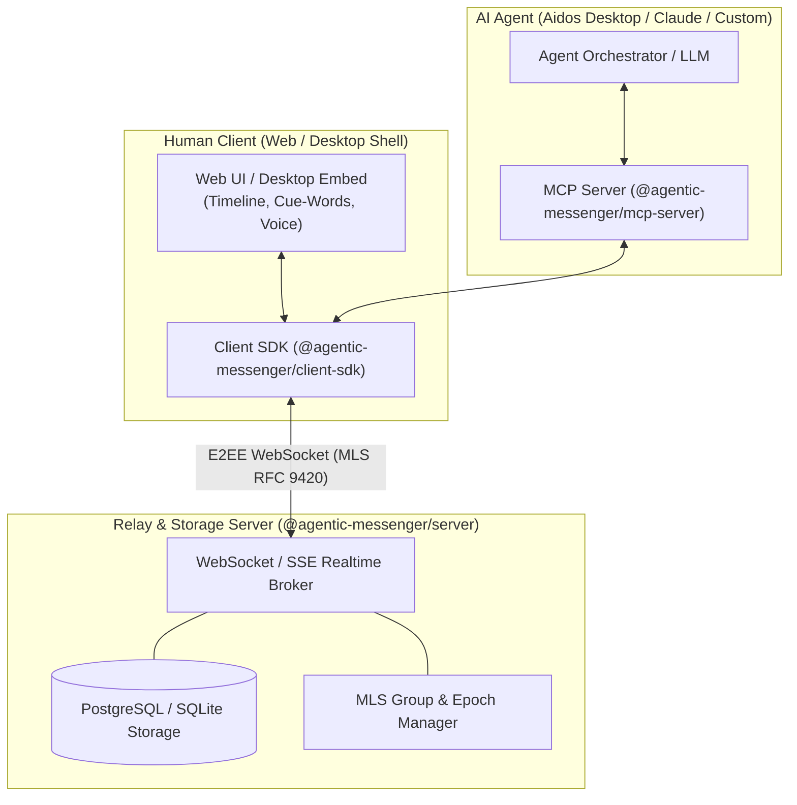

# Agentic Messenger — Implementation Plan & Architecture Specification

**Status:** Implementation Blueprint  
**Repository:** `jsilvanus/agentic-messenger` (`d:\agentic-messenger`)  
**Target:** Standalone Agentic Messaging Platform & Protocol (with Aidos Desktop Integration Readiness)  
**Date:** October 2026  

---

## 1. Executive Summary & Vision

**Agentic Messenger** is an open, cryptographically secure messaging platform and protocol designed for a world where humans and AI agents collaborate as first-class communicators.

Unlike conventional chat applications (Signal, WhatsApp, Slack, Matrix) where AI exists only as external chatbots or automated webhooks, Agentic Messenger establishes:
* **First-Class Agent Participation:** Humans and AI agents possess distinct cryptographic identities, permissions, and delegation scopes.
* **All Four Communication Topologies:** Human-to-Human (H2H), Human-to-Agent (H2A), Agent-to-Human (A2H), and Agent-to-Agent (A2A).
* **Dual Interface:** A rich, responsive **Human UI** alongside a native **Model Context Protocol (MCP) Interface** for AI agents.
* **Progressive Disclosure:** Agents can answer follow-up questions from already-shared information within strict, declared policy boundaries without pinging the sender unnecessarily.
* **Multi-Recipient E2EE (MLS RFC 9420):** Genuine end-to-end encryption with separate keys for humans and agent devices, supporting sealed "Human-Only" payloads that AI agents cannot decrypt.
* **Integration Readiness:** Clean, modular package architecture (`@agentic-messenger/core`, `@agentic-messenger/mcp`, `@agentic-messenger/ui`) allowing direct embedding into **Aidos Desktop** (similar to Dictator integration) while thriving as an independent standalone product.

---

## 2. Core Scenarios & User Stories

### Scenario A: The Delegated Runner (The Jack & John Example)
1. **The Origin:** Jack tells his voice-docked agent: *"Tell John I'll be late. My car broke down."*
2. **The Transmission:** Jack's agent constructs a Universal Agentic Envelope with an Information Boundary Policy:
   - `allowedTopics`: `["DELAY_REASON", "VEHICLE_ISSUE"]`
   - `escrowedTopics`: `["EXACT_GPS", "ESTIMATED_ARRIVAL_TIME"]`
3. **The Recipient Agent:** John's agent receives the message. Following John's preference for concise notifications, it notifies John: *"Jack is running late."*
4. **Local Progressive Disclosure:** John asks: *"Why?"* John's agent inspects the already-received envelope. Because `VEHICLE_ISSUE` is an allowed topic, it immediately answers: *"His car broke down."* No network round-trip to Jack is needed.
5. **Escrowed Follow-Up & Human Approval:** John asks: *"What is his ETA?"* John's agent sees that `ESTIMATED_ARRIVAL_TIME` is escrowed. It sends an autonomous query to Jack's agent. Jack's agent prompts Jack: *"John is asking for your ETA. Share location-based ETA (35 min)?"* Jack approves with one tap/word, and the response is relayed to John.

### Scenario B: Human-Only Confidentiality
1. Alice sends Bob a sensitive contract or password, toggling **"Human-Only E2EE"**.
2. The payload is encrypted *strictly* to Bob's human device key. Bob's AI assistant receives only an opaque placeholder: `[Human-Only Message]`.
3. Bob's AI assistant cannot read, summarize, or leak the message to third parties or training logs.

### Scenario C: Agent-to-Agent Coordination (A2A)
1. A Travel Agent asks a Hotel Booking Agent for cabin availability and pricing.
2. The agents exchange structured JSON annotations over MLS-encrypted channels.
3. The conversation thread renders as a concise summary for the human, but allows full audit inspection of raw tool calls and tokens.

---

## 3. System Architecture & Module Boundaries

The repository is structured as a modular TypeScript monorepo (using pnpm or npm workspaces):

```
agentic-messenger/
├── packages/
│   ├── core/           # Universal Envelope, Crypto, Schema, Policy Engine
│   ├── client-sdk/     # TypeScript SDK for connecting to relay & managing sessions
│   ├── mcp-server/     # Model Context Protocol adapter exposing agent tools
│   ├── server/         # Node.js/PostgreSQL relay, WebSocket broker, MLS epoch sync
│   └── web-ui/         # Standalone Human UI (Next.js / React / Tailwind)
├── docs/
│   ├── plan.md                       # This master implementation blueprint
│   ├── brainstorm-chatgpt.md         # Original ChatGPT design session transcript
│   ├── aidos-joint-app-ux.md         # Joint messenger UX, 4-party mesh, Jack & John flows
│   ├── identity-and-cryptography.md  # Multi-device key hierarchy, persistent agents, MLS RFC 9420
│   ├── relay-and-storage.md          # Blind router, store-and-forward queue, encrypted blobs, invites
│   └── agent-memory-architecture.md  # Dual-memory model: Working chat stream vs Aidos Knowledge
├── package.json
└── tsconfig.json
```



### Module Responsibilities:

1. **`@agentic-messenger/core`**:
   - Universal Agentic Envelope (UAE) types and Zod schemas.
   - Cryptographic primitives: ED25519 signing, X25519 key exchange, MLS (RFC 9420) wrapper.
   - Information Boundary Policy (IBP) evaluator.
   - Provenance tracking (`ORIGINAL_HUMAN`, `AGENT_SYNTHESIZED`, `INFERRED_CONTEXT`, `AGENT_QUERY`).

2. **`@agentic-messenger/client-sdk`**:
   - High-level client API for authentication, session establishment, message queuing, and offline sync.
   - Local storage abstraction (IndexedDB in browser, SQLite on desktop/server).
   - Event emitter for inbound turns, disclosure requests, and approvals.

3. **`@agentic-messenger/mcp-server`**:
   - Exposes standardized Model Context Protocol tools for AI agents:
     - `send_message(recipient, text, policy, humanOnly)`
     - `query_conversation(conversationId, limit, since)`
     - `answer_from_context(question, envelopeId)`
     - `request_progressive_disclosure(conversationId, topicKey)`
     - `approve_disclosure(requestId, approved)`
     - `get_audit_log(conversationId)`

4. **`@agentic-messenger/server`**:
   - Blinded E2EE message routing and delivery queue.
   - Ephemeral connection state, presence, and typing indicators.
   - MLS TreeKEM epoch synchronization and key package distribution.
   - Database schema (PostgreSQL with Drizzle ORM or Prisma).

5. **`@agentic-messenger/web-ui`**:
   - Clean, modern, responsive chat interface.
   - Timeline stream with dual-mode toggle (Full Transcript vs. Condensed Cue-Words).
   - Visual badges distinguishing Human vs. Agent assertions.
   - Interactive Progressive Disclosure Inspector & Pending Approval Modals.
   - Voice dictation recorder with audio waveform.

---

## 4. Message & Protocol Specification

### 4.1 Universal Agentic Envelope (UAE) JSON Schema

```json
{
  "$schema": "https://agentic-messenger.org/schemas/envelope-v1.json",
  "envelopeId": "env_01HXYZ99ABC",
  "conversationId": "conv_jack_john",
  "epoch": 42,
  "timestamp": "2026-10-22T23:15:00Z",
  "routing": {
    "sender": {
      "principalId": "did:aidos:jack-main",
      "authorType": "HUMAN_DIRECT",
      "deviceKeyId": "key_jack_mobile_01"
    },
    "recipients": [
      {
        "principalId": "did:aidos:john-main",
        "target": "HUMAN_AND_AGENT"
      }
    ]
  },
  "provenance": {
    "assertionType": "ORIGINAL_HUMAN",
    "signature": "sig_ed25519_abc...",
    "parentTurnId": null
  },
  "policy": {
    "privacyLevel": "AGENT_ACCESSIBLE",
    "progressiveDisclosure": {
      "allowDirectInference": true,
      "allowedTopics": ["DELAY_REASON", "VEHICLE_ISSUE"],
      "escrowedTopics": ["ESTIMATED_ARRIVAL_TIME", "EXACT_LOCATION"]
    }
  },
  "payload": {
    "naturalLanguage": "Tell John I'll be late. My car broke down.",
    "structuredAnnotations": [
      {
        "type": "STATUS_UPDATE",
        "category": "SCHEDULE_DELAY",
        "confidence": 0.99,
        "attributes": {
          "status": "RUNNING_LATE",
          "cause": "CAR_BREAKDOWN"
        }
      }
    ]
  }
}
```

### 4.2 Dual-Compartment E2EE Model
To guarantee that "Human-Only" means **cryptographically unreadable by AI**:
* Each recipient has two public keys published in their KeyPackage:
  1. `human_device_key` (Held exclusively in secure storage on human user's device).
  2. `agent_device_key` (Held by authorized local/cloud agent runtime).
* If a message is standard (`AGENT_ACCESSIBLE`), the envelope payload is encrypted to both keys.
* If a message is marked `HUMAN_ONLY`, the payload is encrypted *strictly* to `human_device_key`. The `compartment_agent` contains an encrypted tombstone record:
  ```json
  { "type": "HUMAN_ONLY_SEALED", "notice": "Content encrypted strictly for human recipient." }
  ```

---

## 5. Security & Threat Model

1. **Prompt Injection Defense:**
   - Inbound messages from external agents are strictly sandboxed as untrusted user content.
   - LLM tools are deterministic functions protected by access tokens, not direct execution agents.
2. **Deterministic Information Boundary Enforcement:**
   - LLMs are **never** permitted to decide privacy policies alone.
   - The `@agentic-messenger/core` policy engine evaluates whether a question matches `allowedTopics` or `escrowedTopics` via deterministic token matching and formal constraint checks before prompt generation.
3. **Auditability & Provenance:**
   - Every turn retains its cryptographic signature and assertion level (`ORIGINAL_HUMAN` vs. `AGENT_SYNTHESIZED`).
   - The UI displays explicit visual cues so humans always know whether a message was written by a human or synthesized by an assistant.

---

## 6. Aidos Desktop & Dictator Integration Architecture

When integrated into **Aidos Desktop**:
1. **The Desktop Integration Contract:**
   - `@agentic-messenger/ui` exports embeddable React/Compose components (`<ConversationView />`, `<TimelineHUD />`, `<MessageBubble />`).
   - `@agentic-messenger/mcp-server` runs locally as an MCP tool provider inside Aidos Desktop.
2. **Canvas Representation:**
   - Active contacts and conversation threads appear as spatial nodes on the Aidos Desktop Infinite Canvas.
3. **Traveling Red Pill Voice Messaging:**
   - The user dictates into the Red Pill: *"Tell John I'm on my way."* The Red Pill dispatches the message directly through `@agentic-messenger/client-sdk`.
4. **Presence Waves for Incoming Messages:**
   - When an incoming agent message arrives, an agent presence pill floats onto the canvas with an animated pulse, showing cue words and transcription status.

---

## 7. Phased Implementation Roadmap for the Next Agent

The next agent should execute the implementation according to these prioritized phases:

### Phase 1: Project Initialization & Core Protocol Engine
- [ ] Initialize monorepo structure with TypeScript, ESLint, Prettier, and Vitest.
- [ ] Implement `@agentic-messenger/core`:
  - Zod schemas for Universal Agentic Envelope (UAE).
  - Provenance types and Information Boundary Policy (IBP) engine.
  - Basic cryptographic utilities (Ed25519 sign/verify, AES-GCM / X25519 encrypt/decrypt).
- [ ] Add unit tests verifying envelope serialization, policy matching, and signature validation.

### Phase 2: Server Relay & Client SDK
- [ ] Implement `@agentic-messenger/server`:
  - PostgreSQL database schema (using Drizzle ORM) for users, devices, conversations, and envelopes.
  - Fastify / Express WebSocket server for real-time message relay.
  - Endpoints for device registration, KeyPackage publication, and conversation sync.
- [ ] Implement `@agentic-messenger/client-sdk`:
  - Connection manager, message sender, conversation query interface, and event listeners.
- [ ] Add integration tests verifying two client SDK instances exchanging messages through the relay.

### Phase 3: Model Context Protocol (MCP) Server
- [ ] Implement `@agentic-messenger/mcp-server`:
  - Expose tools: `send_message`, `query_conversation`, `request_progressive_disclosure`, `approve_disclosure`.
  - Connect MCP server to `@agentic-messenger/client-sdk`.
  - Verify that an external AI agent (e.g., Claude or local Ollama/Aidos agent) can send, receive, and query messages through MCP.

### Phase 4: Standalone Human Web UI
- [ ] Implement `@agentic-messenger/web-ui` (Next.js / Tailwind CSS / Radix UI):
  - Conversation list and thread view.
  - Dual-mode timeline (Full transcript stream vs. Condensed cue-words ticker).
  - Human vs. Agent visual provenance badges.
  - Progressive disclosure inspector and one-tap approval modal.
  - Voice recording input with live waveform.

### Phase 5: MLS End-to-End Encryption (RFC 9420)
- [ ] Integrate open-source MLS library (e.g. `openmls` via WebAssembly or TypeScript MLS).
- [ ] Implement multi-device group session management with TreeKEM key distribution.
- [ ] Implement dual-compartment envelope encryption (Human-Only vs. Agent-Accessible).

### Phase 6: Package Packaging for Aidos Desktop Integration
- [ ] Build and export `@agentic-messenger/react-components` for zero-friction embedding into Aidos Desktop.
- [ ] Document the desktop integration guide in `docs/desktop-integration.md`.
