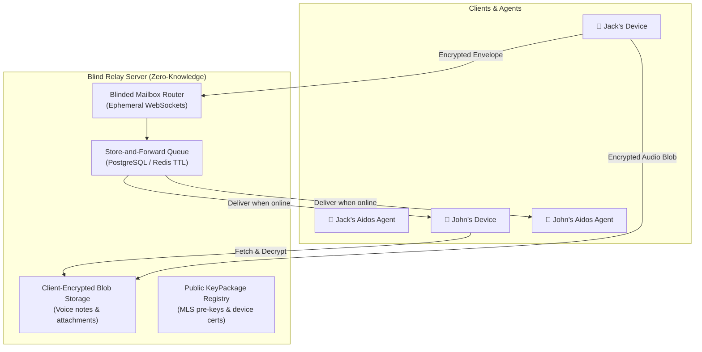

# Blind Relay, Queue, & Blob Storage Specification

**Status:** Technical Specification  
**Architecture:** Zero-Knowledge Relay & Store-and-Forward Cache  
**Date:** October 2026  

---

## 1. Zero-Knowledge Design Philosophy

The server operates strictly as a **Blind Broker**:
* It **never** has access to plaintext message bodies, audio bytes, or metadata annotations.
* It **never** runs LLM models or agent reasoning logic.
* It routes messages based solely on blinded mailbox identifiers.

---

## 2. Server Architecture



---

## 3. Core Server Subsystems

### 3.1 Blinded Mailboxes (Routing Tokens)
* Devices do not connect using human handles or static user IDs.
* A device registers a blinded token:
  $$\text{mailbox\_id} = \text{HMAC-SHA256}(K_{\text{epoch}}, \text{device\_id})$$
* The server routes inbound encrypted envelopes to active WebSockets matching `mailbox_id`.

### 3.2 Ephemeral Store-and-Forward Queue
* If a target device or agent is offline:
  1. The server retains the encrypted envelope in a delivery queue.
  2. Each entry carries a Time-to-Live (TTL) (default: 14 days).
  3. When the recipient device reconnects, it retrieves pending envelopes.
  4. Upon receiving a cryptographic Delivery ACK signed by the recipient device, the server permanently purges the ciphertext from storage.

### 3.3 Client-Encrypted Blob Storage (Voice Dictation & Attachments)
For voice dictation (Red Pill audio recordings) and large media files:
1. **Local Encryption:** Sender generates a random 256-bit symmetric key $K_{\text{media}}$ (AES-256-GCM).
2. **Upload:** Sender uploads the ciphertext blob to the blind storage server.
3. **Envelope Reference:** The sender includes the blob reference inside the E2EE envelope payload:
   ```json
   {
     "type": "AUDIO_VOICE_NOTE",
     "blobUrl": "https://relay.aidos.net/blobs/b_98127394abc",
     "sha256": "e3b0c44298fc1c149afbf4c8996fb92427ae41e4649b934ca495991b7852b855",
     "encryptionKey": "base64_encoded_key...",
     "durationSeconds": 4.8
   }
   ```
4. **Zero-Knowledge Guarantee:** The server holds only raw ciphertext bytes and cannot listen to or transcribe voice notes.

---

## 4. Contact Directory & "Calling Someone In" (Invites & Fallback)

### 4.1 Contact Directory
* Users publish their Account Identity Public Key ($IK$) mapped to their handle or phone number (hashed via Argon2/HMAC commitments to prevent server directory harvesting).
* Clients query the directory to obtain the recipient's **Public KeyPackages** for session initiation.

### 4.2 "Call Into Application" (Universal Web Link)
To communicate with someone who does not yet have Aidos installed:
1. **Invite Creation:** John generates an invite link for Bob:
   `https://chat.aidos.net/join#room=conv_abc&key=k_ephemeral_xyz`
2. **Ephemeral Web Client:** When Bob opens the link:
   - A lightweight Web Client runs directly in Bob's browser.
   - An ephemeral in-browser keypair is created in IndexedDB.
   - An MLS handshake completes over WebSockets.
   - Bob can chat with John immediately without installing software.
3. **Promotion to Full Aidos:**
   - If Bob later downloads Aidos Desktop or Android, a "Link Device" QR code transfers his browser session into his permanent Aidos environment.
