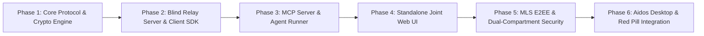

# Agentic Messenger Platform (AMP) — Development Roadmap

**Status:** Engineering Roadmap & Milestones  
**Target:** Standalone Messenger + Aidos Joint Integration  
**Date:** October 2026  

---

## 🗺️ Milestone Overview

---

## Milestone 1: Core Protocol & Policy Engine (`@agentic-messenger/core`)
**Goal:** Deterministic foundation for messages, schemas, identity records, and progressive disclosure policies.

* [ ] **Monorepo Setup:** Initialize pnpm / npm workspace with TypeScript 5+, ESLint, Prettier, and Vitest.
* [ ] **Universal Agentic Envelope (UAE):**
  - Zod schemas for envelope structures (`envelopeId`, `conversationId`, `routing`, `provenance`, `policy`, `payload`).
  - Typed annotations (`status`, `cause`, `eta`, `location`, `custom`).
* [ ] **Deterministic Information Boundary Engine (IBP):**
  - Policy evaluator matching queries against `allowedTopics` and `escrowedTopics`.
  - Zero-LLM deterministic security checks.
* [ ] **Crypto Primitives (v0.1):**
  - Ed25519 identity signing and signature verification.
  - X25519 key exchange + AES-256-GCM symmetric encryption/decryption.
* [ ] **Verification:** Vitest test suite testing serialization, policy boundary matching, and envelope cryptographic verification.

---

## Milestone 2: Blind Relay Server & Client SDK (`@agentic-messenger/server` & `@agentic-messenger/client-sdk`)
**Goal:** Real-time store-and-forward message delivery with zero-knowledge routing.

* [ ] **Blind Relay Server:**
  - Fastify / Node.js WebSocket broker for blinded mailbox subscriptions (`mailbox_id`).
  - Drizzle ORM + SQLite/PostgreSQL schema:
    - `devices` & `key_packages` (identity public keys and pre-keys).
    - `message_queue` (ephemeral store-and-forward queue with TTL and delivery ACKs).
    - `encrypted_blobs` (client-encrypted voice dictation audio and attachments).
* [ ] **Client SDK (`@agentic-messenger/client-sdk`):**
  - Connection manager (WebSocket auto-reconnect, heartbeat, offline queue).
  - Outbox queue: persists pending messages in local storage (IndexedDB / SQLite).
  - Working Memory engine: local annotation index for fast query retrieval.
* [ ] **Verification:** Automated integration test with two headless SDK instances exchanging messages, handling offline disconnects, and validating queue purging on ACK.

---

## Milestone 3: Model Context Protocol (MCP) Server (`@agentic-messenger/mcp-server`)
**Goal:** Allow any AI agent (Claude, Cursor, local Aidos runner, Ollama) to be a first-class participant.

* [ ] **MCP Tools Implementation:**
  - `send_message(recipient, text, policy, humanOnly)`: Dispatches encrypted envelopes.
  - `query_conversation(conversationId, limit, since)`: Retrieves working memory thread history.
  - `answer_from_context(question, envelopeId)`: Evaluates local annotations against allowed topics.
  - `request_progressive_disclosure(conversationId, topicKey)`: Sends structured escalation queries.
  - `approve_disclosure(requestId, approved)`: Approves escrowed disclosure requests.
  - `get_audit_log(conversationId)`: Audits provenance signatures and policy decisions.
* [ ] **Verification:** Run a simulated Jack-and-John scenario with two agent processes conversing through MCP tools over the relay.

---

## Milestone 4: Standalone Joint Human Web UI (`@agentic-messenger/web-ui`)
**Goal:** Rich, responsive user interface reflecting the 4-party conversation mesh.

* [ ] **Next.js + Tailwind CSS UI:**
  - Conversation sidebar: active threads, unread counts, and agent activity badges.
  - Message thread view with distinct visual badges:
    - `👤 Human Direct`
    - `🤖 Delegated Runner`
    - `🔒 Human-Only E2EE`
  - Dual-View toggle: Natural Language stream vs. Condensed Cue-Words ticker.
* [ ] **Progressive Disclosure Inspector:**
  - Interactive chip showing disclosed vs escrowed metadata.
  - One-tap approval modal for pending assistant requests.
* [ ] **Audio Dictation Player:**
  - Audio waveform player with inline transcription chips.
* [ ] **Zero-Install Web Fallback:**
  - Standalone invite URL landing page for temporary browser-based chat.
* [ ] **Verification:** Playwright end-to-end tests for chatting, toggling Human-Only mode, and approving disclosure prompts.

---

## Milestone 5: Production E2EE & MLS (RFC 9420) Multi-Device
**Goal:** Industry-standard group encryption, multi-device key management, and hardware isolation.

* [ ] **MLS Integration:**
  - Integrate audited MLS library (`openmls` via WebAssembly or TypeScript MLS).
  - Leaf node management: separate leaf nodes for Phone, Laptop, and Aidos Agent.
  - TreeKEM group epoch transitions on member/device joins and removals.
* [ ] **Device Pairing & Cross-Signing:**
  - QR-code pairing flow for linking secondary desktop/mobile devices.
  - Cryptographic revocation certificates for compromised/lost devices.
* [ ] **Dual-Compartment Enforcement:**
  - Verification that `HUMAN_ONLY` payloads withhold content keys from agent leaves.
* [ ] **Verification:** Multi-client test asserting that agent nodes receive sealed tombstones and cannot decrypt human-only payloads.

---

## Milestone 6: Aidos Desktop & Dictator Integration
**Goal:** Deep native integration with the Aidos operating environment and Dictator Red Pill.

* [ ] **Component Export (`@agentic-messenger/react-components`):**
  - Embeddable `<ConversationView />`, `<PresenceWaves />`, and `<CueTicker />`.
* [ ] **Aidos Canvas Spatial Node:**
  - Contact nodes with live presence indicators and floating notification pulses.
* [ ] **Dictator / Red Pill Audio Bridge:**
  - Piped voice dictation from the traveling Red Pill directly into the AMP client SDK.
* [ ] **Aidos Persistent Knowledge Bridge:**
  - Sync contact dossiers and intent commitments into the Aidos local Knowledge & Intent Graph.
* [ ] **Verification:** End-to-end user testing inside Aidos Desktop environment.
