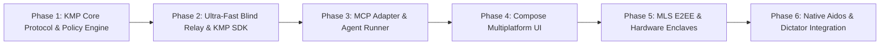

# Agentic Messenger Platform (AMP) — Development Roadmap

**Status:** Engineering Roadmap & Milestones (Kotlin Multiplatform + High-Efficiency Relay)  
**Target:** Standalone Messenger + Aidos & Dictator Native Integration  
**Date:** October 2026  

---

## 🗺️ Milestone Overview

---

## Milestone 1: KMP Core Protocol & Policy Engine (`amp-core`)
**Goal:** Deterministic Kotlin Multiplatform foundation for schemas, serialization, provenance, and policy evaluation.

* [ ] **KMP Gradle Workspace:** Initialize root `build.gradle.kts` and `settings.gradle.kts` targeting JVM, Android, and Native/Desktop.
* [ ] **Universal Agentic Envelope (UAE):**
  - Data classes with `kotlinx.serialization` for envelopes, routing headers, provenance records, and typed annotations.
  - JSON and CBOR binary serialization support.
* [ ] **Deterministic Information Boundary Engine (IBP):**
  - Policy evaluator matching queries against `allowedTopics` and `escrowedTopics`.
  - Zero-LLM deterministic security checks.
* [ ] **Basic Crypto Interfaces (`amp-crypto`):**
  - Ed25519 signing/verification.
  - X25519 key agreement + AES-256-GCM symmetric encryption.
* [ ] **Verification:** Kotlin Test suite running across JVM and Android verifying envelope serialization, signature checks, and policy matching.

---

## Milestone 2: Ultra-Fast Blind Relay & KMP Client SDK (`amp-server` & `amp-client-sdk`)
**Goal:** Microsecond blinded routing and resilient client connection manager.

* [x] **High-Efficiency Blind Relay Server (`amp-server`):**
  - Implemented in **Rust (Tokio + Axum)** or **Ktor / Netty (GraalVM Native)** for maximum throughput and minimal memory (< 15 MB RAM idle).
  - Blinded mailbox router (`mailbox_id = HMAC(epoch, device_id)`).
  - Ephemeral store-and-forward queue with strict TTL and delivery ACKs (SQLite / PostgreSQL).
  - Client-encrypted blob store for voice dictation audio and attachments.
* [ ] **KMP Client SDK (`amp-client-sdk`):**
  - Ktor WebSocket client with exponential backoff auto-reconnect and heartbeat.
  - Outbox queue: local message staging.
  - Working Memory engine: local annotation index powered by **SQLDelight** (type-safe SQLite across Android and Desktop).
* [ ] **Verification:** Integration tests with two headless KMP SDK instances exchanging messages through the blind relay and verifying queue cleanup on delivery ACKs.

---

## Milestone 3: Model Context Protocol (MCP) Server (`amp-mcp`) [DEFERRED]
**Status:** Deferred for later iteration (internal agent harness handles privacy boundaries; external MCP disclosure policies require deeper review).
**Goal:** First-class participation for external and local AI agents.

* [ ] **MCP Tools Implementation:**
  - `send_message(recipient, text, policy, humanOnly)`: Dispatches encrypted envelopes.
  - `query_conversation(conversationId, limit, since)`: Retrieves working memory thread history.
  - `answer_from_context(question, envelopeId)`: Evaluates local annotations against allowed topics.
  - `request_progressive_disclosure(conversationId, topicKey)`: Sends structured escalation queries.
  - `approve_disclosure(requestId, approved)`: Approves escrowed disclosure requests.
  - `get_audit_log(conversationId)`: Audits provenance signatures and policy decisions.
* [ ] **Verification:** Multi-agent test simulating Jack and John's agents resolving progressive disclosure queries through MCP.

---

## Milestone 4: Compose Multiplatform UI (`amp-ui`)
**Goal:** Shared native UI for Android, Desktop (Windows/macOS/Linux), and Web (Wasm).

* [ ] **Compose Multiplatform UI Components:**
  - Conversation thread view with distinct visual provenance badges:
    - `👤 Human Direct`
    - `🤖 Delegated Runner`
    - `🔒 Human-Only E2EE`
  - Dual-View toggle: Natural Language stream vs. Condensed Cue-Words ticker.
  - Progressive disclosure inspector and 1-tap approval modal.
  - Audio dictation playback with waveform rendering.
* [ ] **Web Fallback (Kotlin/Wasm):**
  - Browser-based ephemeral client for zero-install invite links.
* [ ] **Verification:** Compose Desktop & Android UI tests for chat interactions and approval modals.

---

## Milestone 5: MLS E2EE & Hardware Enclave Key Storage
**Goal:** Production multi-device group encryption and tamper-proof hardware security.

* [ ] **MLS (RFC 9420) Integration:**
  - TreeKEM group epoch management with distinct leaf keys for Human Phone, Human Laptop, and Aidos Agent.
  - Sealed dual-compartment `HUMAN_ONLY` payloads.
* [ ] **Hardware Security Integration:**
  - Android: Android KeyStore and **StrongBox** hardware-backed keys.
  - Desktop: OS Keychain / DPAPI storage.
* [ ] **Device Pairing & Revocation:**
  - Ephemeral QR cross-signing ceremony for secondary device linking.
  - Cryptographic revocation certificates and epoch ratchet updates.
* [ ] **Verification:** Cryptographic test asserting that agent leaf nodes receive sealed tombstones and cannot decrypt human-only payloads.

---

## Milestone 6: Native Aidos & Dictator Integration
**Goal:** In-process embedding with zero IPC friction.

* [ ] **Aidos Project Dependency:**
  - Include `:amp-core`, `:amp-client-sdk`, and `:amp-ui` directly in `aidos/build.gradle.kts`.
* [ ] **Aidos Canvas Spatial Node:**
  - Conversational presence nodes on the Aidos infinite canvas with animated pulse waves.
* [ ] **Dictator Red Pill Audio Bridge:**
  - Direct in-memory audio pipe from `dictator-kotlin` into `amp-client-sdk` for voice messaging.
* [ ] **Persistent Memory Bridge:**
  - Bi-directional sync between AMP working memory and the Aidos Knowledge & Intent Graph.
* [ ] **Verification:** Live end-to-end testing inside the compiled Aidos Desktop and Android environment.
